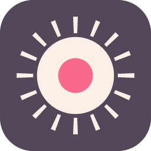

<div align="center">



# Daymark

**Rencanakan hari. Jaga fokus.**

Workspace desktop lokal untuk tugas, proyek, catatan, dan kalender yang hidup
di Dynamic Island di tepi layar Anda.

<br>

[](https://github.com/DayenM/Daymark/releases/latest)
[](https://github.com/DayenM/Daymark/releases)
[](LICENSE)
[](https://github.com/DayenM/Daymark/releases/latest)

**[Unduh untuk Windows](https://github.com/DayenM/Daymark/releases/latest)**
&nbsp;·&nbsp;
[Fitur](#fitur)
&nbsp;·&nbsp;
[Jalankan dari source](#jalankan-dari-source)
&nbsp;·&nbsp;
[English](README.md)

</div>

<br>

## Mengapa Daymark

Kebanyakan aplikasi tugas meminta Anda membuka jendela, mencari daftar, dan berpindah konteks sebelum mulai bekerja.
Daymark menjaga hari ini tetap sekali lirik: sebuah notch kecil di tepi layar yang terbuka menjadi
kalender dan daftar tugas Anda, lalu menutup lagi saat selesai.

Semua tulisan Anda tersimpan di perangkat. Tanpa akun, tanpa layanan sinkronisasi, tanpa telemetri.

## Fitur

<table>
<tr>
<td width="50%" valign="top">

### Dynamic Island
Panel bergaya notch yang terbuka menjadi hari Anda. Seret ke tepi atas, kiri, atau kanan monitor mana pun;
posisinya diingat. Klik tiga kali untuk mengembalikannya ke tengah.

</td>
<td width="50%" valign="top">

### Kalender sebagai awal
Daymark terbuka di papan bulanan selebar jendela, dengan setiap tugas dan jamnya terbaca sekilas.
Ukuran kalender bebas diatur dan sidebar dapat dilipat untuk ruang lebih luas.

</td>
</tr>
<tr>
<td width="50%" valign="top">

### Tugas yang detail
Prioritas, tanggal, pengingat, pengulangan, proyek, tag, satu tingkat subtugas,
dan catatan Markdown, semuanya divalidasi di Rust sebelum masuk database.

</td>
<td width="50%" valign="top">

### Tangkap dari mana saja
Tekan <kbd>Ctrl</kbd> + <kbd>Shift</kbd> + <kbd>Y</kbd> dari aplikasi apa pun untuk mencatat tugas tanpa
meninggalkan pekerjaan. Pengingat tiba sebagai notifikasi Windows.

</td>
</tr>
<tr>
<td width="50%" valign="top">

### Tujuh tema
Glass terang dan gelap dalam hitam-putih, Neumorphic, serta Sakura Milk, Peach Matcha,
Cherry Cola, dan Midnight Ocean. Transparansi panel dan jendela dapat diatur.

</td>
<td width="50%" valign="top">

### Lokal dan ringan
SQLite dengan WAL di disk Anda sendiri, backup dan impor JSON, serta hanya satu jendela aktif
saat idle. Berjalan bersama Windows dan memperbarui diri dari rilis bertanda tangan.

</td>
</tr>
</table>

## Instalasi

1. Buka [rilis terbaru](https://github.com/DayenM/Daymark/releases/latest).
2. Unduh `Daymark_X.Y.Z_x64-setup.exe` dari bagian **Assets**.
3. Jalankan installer.

Anda tidak perlu Node.js, Rust, atau terminal. Installer membawa bootstrapper WebView2;
jika WebView2 Runtime belum ada, koneksi internet diperlukan satu kali untuk mengunduhnya.

Sudah terpasang? Buka **Pengaturan → Pembaruan aplikasi → Periksa pembaruan**. Daymark juga memeriksa di latar belakang
dan baru memasang versi baru setelah Anda memilih **Pasang**.

> **Memakai versi 0.1.6?** Versi itu belum memiliki updater. Pasang rilis terbaru secara manual satu kali;
> setelahnya semua pembaruan berlangsung di dalam aplikasi.

## Data Anda

Workspace disimpan di database SQLite lokal pada direktori data aplikasi Windows. Pemeriksaan pembaruan
tidak mengunggah tugas Anda. Ekspor backup JSON kapan saja dari **Pengaturan → Backup workspace**.

Windows dapat menunda notifikasi saat Do Not Disturb aktif atau perangkat tidur. Daymark memeriksa ulang
pengingat ketika menerima sinyal resume.

## Teknologi

| Lapisan | Teknologi | Peran |
| --- | --- | --- |
| Shell | [Tauri v2](https://tauri.app) | Jendela, tray, startup, hotkey global, notifikasi, updater |
| Antarmuka | React 19, TypeScript, Vite | Panel Island dan workspace penuh |
| Native | Rust | Perintah, scheduler pengingat, validasi, akses data |
| Penyimpanan | SQLite (WAL) lewat `rusqlite` | Tugas, proyek, catatan, dan pengaturan di perangkat |
| Runtime | Microsoft WebView2 | Merender UI tanpa membundel browser kedua |

Jendela workspace penuh dibuat saat diminta dan dihancurkan saat ditutup; hanya Island yang tetap hidup.
Catatan desain ada di [`docs/performance.md`](docs/performance.md).

## Jalankan dari source

> Hanya untuk developer. Pengguna lain cukup memakai installer di atas.

**Prasyarat:** Node.js 20.19+ atau 22.12+, Rust stable (MSVC) 1.90+,
Microsoft C++ Build Tools (*Desktop development with C++*), dan WebView2 Runtime.

```powershell
npm install
npm run tauri dev      # development
npm run tauri build    # installer NSIS x64
```

Rilis dibuat oleh GitHub Actions saat tag `v*` dipush.
Lihat [`docs/releasing.md`](docs/releasing.md).

## Kontribusi

Issue dan pull request dipersilakan. Untuk perubahan yang lebih besar dari perbaikan kecil, mohon buka issue
terlebih dahulu agar arahnya disepakati.

## Lisensi

Dirilis di bawah [Lisensi MIT](LICENSE). Font yang dibundel tetap memakai
[lisensi SIL OFL](public/licenses) masing-masing.

<div align="center">
<br>
<sub>Dibuat oleh <a href="https://github.com/DayenM">DayenM</a></sub>
</div>
