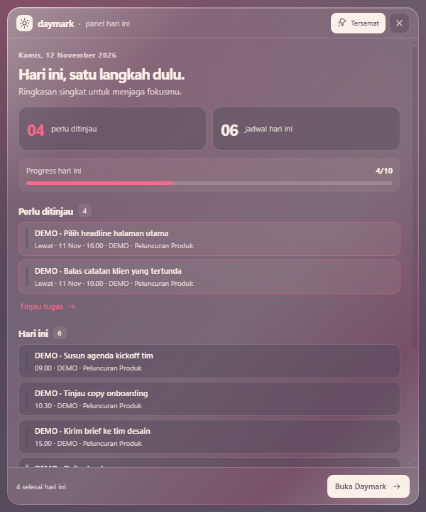

# Daymark

<p align="center">
  <strong>Rencanakan hari. Jaga fokus.</strong><br>
  Workspace desktop lokal untuk tugas, proyek, catatan, kalender, dan pengingat.
</p>

<p align="center">
  <a href="https://github.com/DayenM/Daymark/releases/latest"></a>
  
  
</p>

<p align="center">
  <a href="https://github.com/DayenM/Daymark/releases/latest"><strong>Unduh untuk Windows →</strong></a>
</p>

<p align="center">
  
</p>

## Tentang Daymark

Daymark adalah aplikasi produktivitas desktop yang membantu Anda melihat apa yang perlu dikerjakan hari ini, menangkap tugas dengan cepat, lalu merapikannya dalam satu workspace. Panel hariannya tetap dekat saat dibutuhkan, sementara tugas, proyek, kalender, dan catatan tersimpan lokal di perangkat.

## Keunggulan Daymark

- **Mulai hari dengan jelas** — briefing menampilkan tugas hari ini, hal yang perlu ditinjau, dan progres penyelesaian.
- **Akses dari panel desktop** — buka Dynamic Island, ubah ukurannya, pindahkan, sematkan di atas aplikasi lain, atau sesuaikan transparansinya.
- **Simpan detail tugas** — atur prioritas, jadwal, pengingat, pengulangan, proyek, tag, subtugas, dan catatan Markdown.
- **Atur ritme kerja** — gunakan kalender dengan penanda hari bertugas, mode Fokus, dan mode Istirahat.
- **Tangkap ide seketika** — buka Quick Capture dari mana saja dengan `Ctrl+Shift+T`; pengingat dapat dikirim sebagai notifikasi Windows.
- **Simpan konteks dalam satu tempat** — kelola proyek dan catatan, lalu ekspor atau impor backup JSON.
- **Sesuaikan tampilannya** — pilih Glass terang, Glass gelap, atau Neumorphic dan gunakan keluarga font yang nyaman dibaca.
- **Tetap mudah dijangkau** — Daymark dapat berjalan di system tray dan dibuka bersama Windows; startup dapat diatur dari aplikasi.

## Teknologi

| Bagian | Teknologi | Peran |
| --- | --- | --- |
| Desktop | Tauri v2 | Jendela, tray, startup, hotkey, dan notifikasi Windows |
| UI | React, TypeScript, Vite | Panel harian dan workspace |
| Native | Rust | Perintah aplikasi, scheduler, dan akses data |
| Database | SQLite dengan WAL | Menyimpan tugas, proyek, catatan, dan pengaturan di perangkat |
| Web runtime | Microsoft WebView2 | Merender UI Windows tanpa membundel browser Chromium terpisah |

## Instalasi untuk pengguna Windows

1. Buka [rilis Daymark terbaru](https://github.com/DayenM/Daymark/releases/latest).
2. Unduh `Daymark_X.Y.Z_x64-setup.exe` dari bagian **Assets**.
3. Jalankan installer dan ikuti langkah pemasangan.

Selesai—Anda tidak perlu memasang Node.js, Rust, C++ Build Tools, atau mengetik perintah terminal untuk menggunakan aplikasi. Installer membawa bootstrapper WebView2; jika WebView2 Runtime belum tersedia di Windows, koneksi internet diperlukan agar installer dapat mengunduhnya.

> **Menggunakan Daymark 0.1.6?** Versi tersebut belum memiliki updater. Unduh rilis terbaru dari halaman di atas dan pasang manual satu kali; sesudahnya, Daymark dapat memberi tahu saat pembaruan tersedia dan memasangnya setelah Anda memilih **Pasang**.

## Data dan pembaruan

Workspace disimpan di database lokal pada direktori data aplikasi Windows. Pemeriksaan pembaruan tidak mengunggah database tugas. Backup JSON tersedia di **Pengaturan → Backup workspace**.

Pembaruan aplikasi diterbitkan melalui [GitHub Releases](https://github.com/DayenM/Daymark/releases). Windows dapat menunda notifikasi saat Do Not Disturb aktif atau perangkat tidur; pengingat akan diperiksa kembali ketika aplikasi mendapat sinyal resume.

## Menjalankan dari source

> Bagian ini hanya untuk developer. Pengguna biasa cukup memakai installer di atas.

Prasyarat:

- Node.js 20.19+ atau 22.12+
- Rust stable MSVC 1.90+
- Microsoft C++ Build Tools dengan workload **Desktop development with C++**
- WebView2 Runtime

Jalankan mode development:

```powershell
npm install
npm run tauri dev
```

Build installer NSIS x64:

```powershell
npm run tauri build
```

## Dokumentasi teknis

- [Panduan performa CPU dan memori](docs/performance.md)
- [Panduan merilis Daymark](docs/releasing.md)

## Kontribusi dan lisensi

Kontribusi dapat diajukan melalui pull request. Repo ini belum memiliki file `LICENSE`, sehingga kode belum diberikan lisensi umum untuk digunakan ulang.
